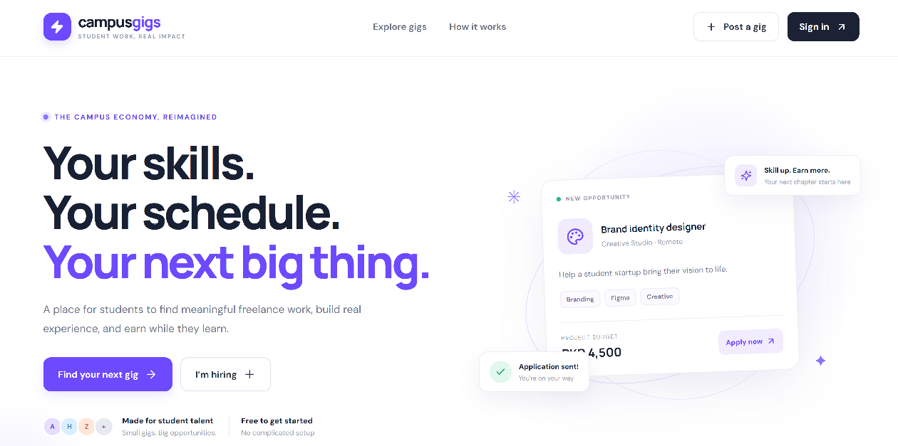
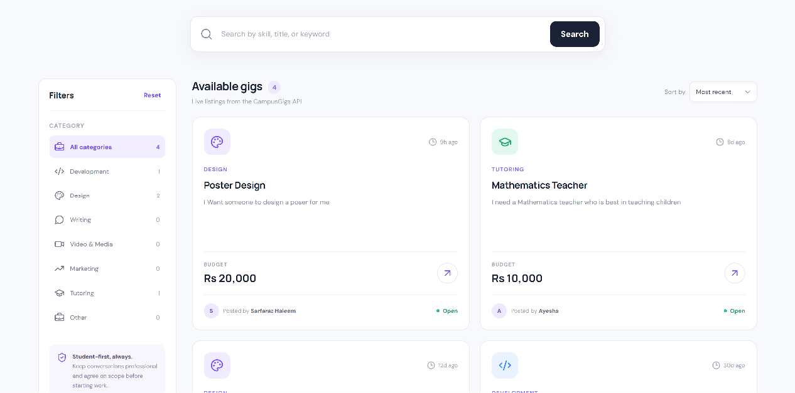
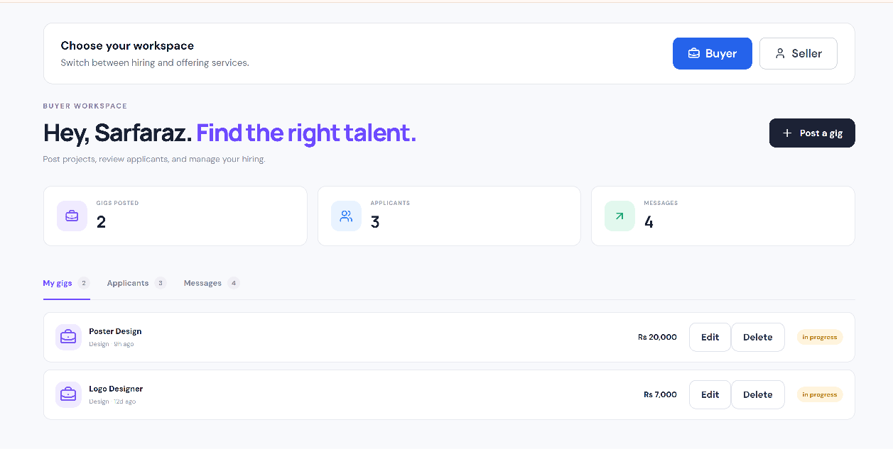
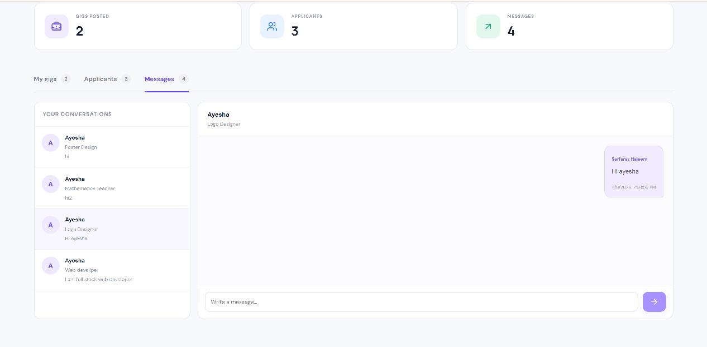

# CampusGigs — Student Micro-Freelance Marketplace

A MERN-stack platform that connects students with short-term freelance opportunities, allowing them to publish gigs, discover projects, submit applications, manage applicants, and communicate through in-app messaging.

**Live Demo:** https://campusgigs-frontend.onrender.com  
**Backend API:** https://campusgigs-1.onrender.com  
**GitHub Repository:** https://github.com/sarfrazhaleem09/CampusGigs

## 1. Project Overview

CampusGigs is a student-focused micro-freelance marketplace developed as part of the Zynvex Solutions Batch 5 Virtual Internship.

The platform helps students find and offer services such as:
- Graphic design
- Video editing
- Programming and web development
- Notes and academic assistance
- Other short-term freelance services

Users can create accounts, publish gigs, browse opportunities, apply for projects, manage applications, and communicate with other users.

## 2. Technology Stack

| Layer | Technologies |
|---|---|
| Frontend | React.js, Vite |
| Styling | CSS |
| Backend | Node.js, Express.js |
| Database | MongoDB Atlas |
| ODM | Mongoose |
| Authentication | JSON Web Tokens (JWT) |
| Password Security | bcryptjs |
| Deployment | Render |
| Version Control | Git and GitHub |

## 3. Main Features

### Authentication
- User registration and login
- Password hashing
- JWT-based authentication
- Protected API routes

### Gig Management
- Create and publish gigs
- Browse available opportunities
- Manage posted gigs
- View gig details

### Search and Discovery
- Search gigs by keywords
- Filter by category
- Sort opportunities

### Application Management
- Apply for gigs
- View submitted applications
- Review received applications
- Accept or reject applicants
- Update gig status

### In-App Messaging
- Create conversations between relevant users
- Send and receive messages
- View conversation history

### Dashboard
- View posted gigs
- Track applications
- Manage received applications
- Access conversations

### Responsive Interface
- Responsive layouts for desktop and mobile devices

## 4. Application Screenshots

### Homepage


### Explore Gigs


### User Dashboard


### Messaging


## 5. Project Structure

```text
CampusGigs/
├── client/
│   ├── public/
│   ├── src/
│   ├── package.json
│   └── ...
├── server/
│   ├── src/
│   │   ├── models/
│   │   ├── routes/
│   │   └── index.js
│   ├── .env.example
│   └── package.json
├── .gitignore
├── package.json
└── README.md
```

## 6. Installation and Setup

### Prerequisites
- Node.js and npm
- MongoDB Atlas account
- Git
- Visual Studio Code (recommended)

### Step 1: Clone the repository

```bash
git clone https://github.com/sarfrazhaleem09/CampusGigs.git
cd CampusGigs
```

### Step 2: Install dependencies

```bash
npm run install:all
```

### Step 3: Configure environment variables

Create a `.env` file inside the `server` directory using `server/.env.example` as a reference.

Configure:

```env
PORT=5000
MONGODB_URI=your_mongodb_atlas_connection_string
JWT_SECRET=your_secure_random_secret
CLIENT_URL=http://localhost:5173
```

For the frontend, configure the Vite API URL using the appropriate local environment file:

```env
VITE_API_URL=http://localhost:5000/api
```

Never commit actual `.env` files, database credentials, or JWT secrets.

### Step 4: Start the application

From the project root:

```bash
npm run dev
```

The frontend and backend development servers should start using the project's development script.

Typical local addresses:

- Frontend: http://localhost:5173
- Backend: http://localhost:5000
- Health endpoint: http://localhost:5000/api/health

## 7. API Overview

The backend exposes REST API route groups:

| Route prefix | Purpose |
|---|---|
| `/api/health` | Backend health check |
| `/api/auth` | Registration and authentication |
| `/api/jobs` | Gig management and discovery |
| `/api/applications` | Application submission and management |
| `/api/messages` | Conversations and messaging |

All protected operations require valid authentication. Consult the corresponding route files in `server/src/routes/` for individual endpoints, HTTP methods, and request parameters.

## 8. Deployment

CampusGigs is deployed using Render, with MongoDB Atlas providing the database.

**Frontend:**  
https://campusgigs-frontend.onrender.com

**Backend:**  
https://campusgigs-1.onrender.com

**Backend health check:**  
https://campusgigs-1.onrender.com/api/health

The frontend communicates with the backend through the `VITE_API_URL` environment variable.

The backend uses environment-specific configuration for database access, authentication, and CORS.

## 9. Testing and Verification

The deployed application has been manually tested for:

- User login and logout
- Dashboard access
- Gig browsing and search
- Gig creation
- Application submission
- Application acceptance and status updates
- In-app messaging
- Desktop and mobile responsiveness
- Backend health endpoint

## 10. Future Improvements

Potential improvements include:

- Email verification and password recovery
- Notifications for new applications and messages
- Unread-message indicators
- Advanced search and pagination
- Automated backend and frontend tests
- Enhanced user profiles and ratings
- Additional production security controls

## 11. Author

**Sarfaraz Haleem**  
MERN Stack Intern — Zynvex Solutions, Batch 5

**Project:** CampusGigs — Micro-Freelance Marketplace for Students

GitHub: https://github.com/sarfrazhaleem09

---

*Developed as an internship project using the MERN stack.*


